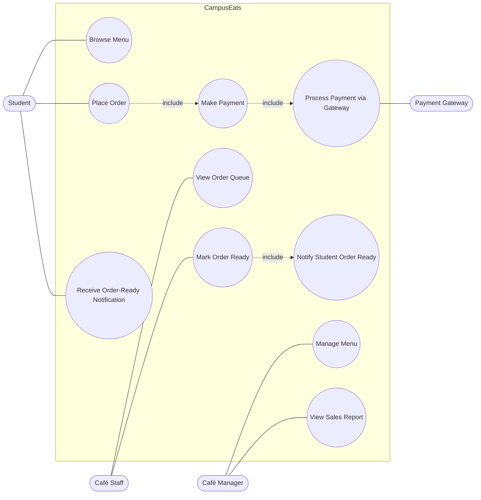
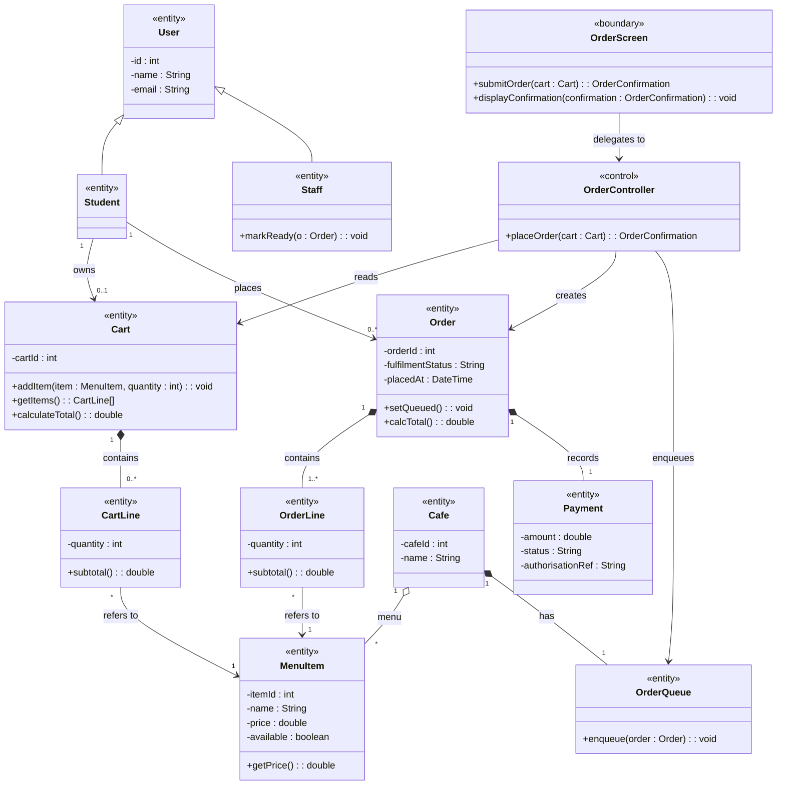
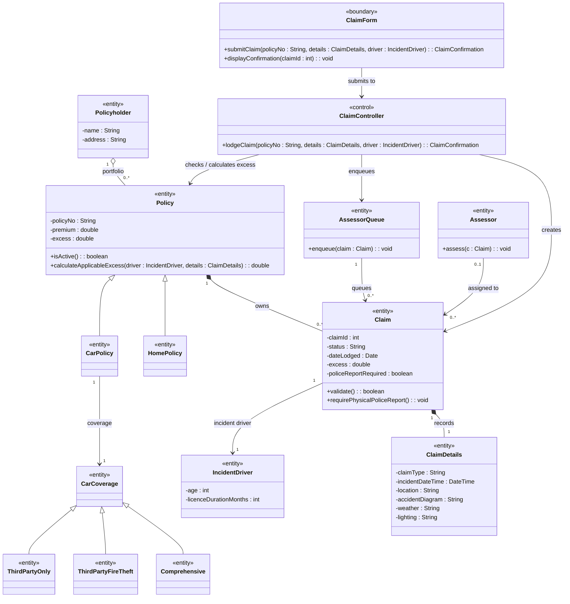
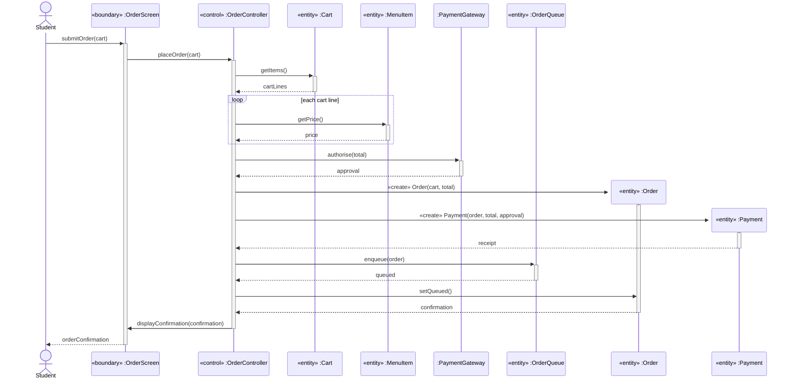
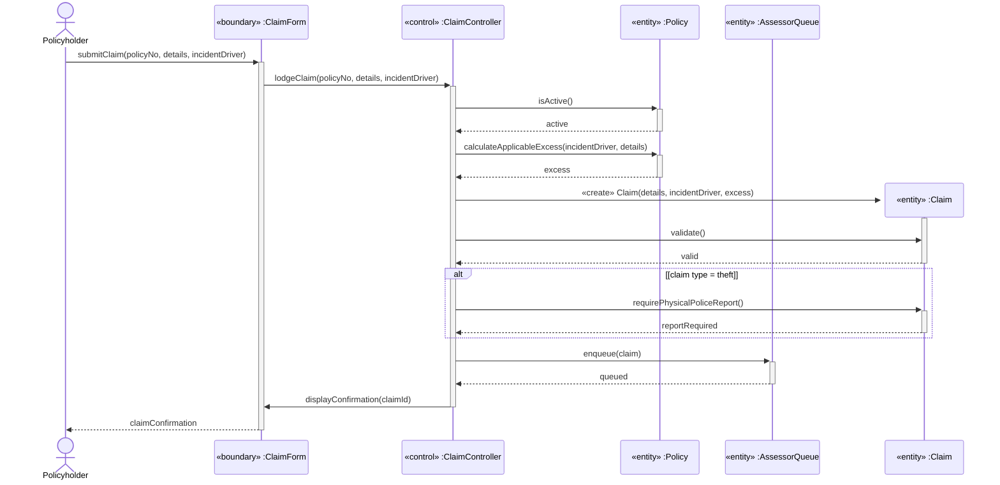

# CSIT314 — Worked Diagrams & Case Descriptions (Part B drawing practice)

Part B may ask you to **draw diagrams and write case descriptions**. This doc gives *complete, exam-ready worked examples* of the three artefacts you're most likely to be asked for:

1. **Use case descriptions** (the detailed written format)
2. **Class diagrams**
3. **Sequence diagrams**

Each uses the **notation taught in the slides** (Topic 3 for use cases/classes, Topic 4 for sequence diagrams). Examples are given on two scenarios: the mock **CampusEats** food-ordering app and the **Lab 1 "Sure Thing Insurance"** claims system. Diagrams are shown as **Mermaid** (renders automatically on GitHub) *and* as **ASCII sketches** so you can see exactly what to put on paper in the exam.

> **In a pen-and-paper exam you draw the ASCII-style version.** The Mermaid blocks are there so the rendered GitHub page shows you the finished shape.

---

## PART 1 — Use Case Descriptions

A **use case diagram** shows actors + use cases + relationships. A **use case description** is the *written* detail behind one use case. The slide format (Topic 3 p.10) uses: **Use Case name, Actor, Description, Basic Flow, Alternative Flows.** The reusable template below adds **Preconditions** and **Postconditions** as helpful exam-detail fields; they are not fields shown in that slide's example:

### Template (memorise this skeleton)
```
Use Case:        <name>
Actor(s):        <primary actor> (+ secondary/external systems)
Description:     <one-sentence goal>
Preconditions:   <what must be true before it starts>
Basic Flow:      1. ... 2. ... 3. ...   (the main success scenario)
Alternative Flows: <branch name>: <what happens instead>
Postconditions:  <what is true after success>
```

### Example A — CampusEats: *Place Order*
```
Use Case:        Place Order
Actor(s):        Student (primary); Payment Gateway (external system)
Description:     A student selects menu items and places a paid order for pickup.
Preconditions:   Student is logged in; the café is open; cart is not empty.
Basic Flow:
  1. The student opens a café's menu and adds items to the cart.
  2. The student proceeds to checkout.
  3. The system displays the order summary and total price.
  4. The student confirms and chooses to pay (include: Make Payment).
  5. The system validates payment via the Payment Gateway.
  6. The system creates the order and places it in the café's live queue.
  7. The system shows an order confirmation with an estimated time.
Alternative Flows:
  5a. Payment is declined: the system shows an error, order is NOT created,
      and the student may retry or cancel.
  *a. Student cancels during checkout: the cart is kept, no order is created.
Postconditions: A paid order exists with status "Queued" in the café's live queue;
      café staff can view it for preparation.
```

### Example B — Sure Thing Insurance: *Lodge Car Insurance Claim*
```
Use Case:        Lodge Claim (Car)
Actor(s):        Policyholder (primary)
Description:     A policyholder lodges an online claim against a car policy.
Preconditions:   Policyholder is authenticated and holds an active car policy.
Basic Flow:
  1. Policyholder selects the car policy to claim against.
  2. System presents the claim form.
  3. Policyholder enters the claim type, date/time, location, and incident-driver details
     needed to calculate the applicable excess (including age and licence duration).
  4. For damage: policyholder records the accident description and diagram, weather and
     lighting conditions, fault, and the other party's/person's/company's insurer details.
     For theft: policyholder records whether the car was locked, garaged, alarmed, and
     steering-locked.
  5. System calculates and records the applicable excess from the claim details.
  6. Policyholder submits the claim.
  7. System creates the claim, records required supporting information, and adds it to an
     assessor queue.
Alternative Flows:
  4a. Theft claim: system records that a physical police report is required.
  *a. Policyholder cancels before submitting: no claim is created or lodged.
Postconditions: A claim exists with status "Lodged" and is queued for assessor assignment;
      the claim is recorded for next year's premium calculation. Assessment, payout,
      billing, fraud investigation, and the two-week theft outcome occur after lodgement.
```

### The matching use case DIAGRAM (CampusEats)



**ASCII version (what you draw on paper):**
```
           +-------------------------- CampusEats ---------------------------+
           |                                                                 |
Student ---+--( Browse Menu )     ( Receive Order-Ready Notification )       |
     \     |                                                                 |
      \----+--( Place Order ) ....«include»....> ( Make Payment )            |
           |                                      |                          |
           |                                      | «include»                |
           |                         ( Process Payment via Gateway )         |
           |                                                                 |
Café Staff-+--( View Order Queue )    ( Mark Order Ready )                   |
           |                                      |                          |
           |                                      | «include»                |
           |                         ( Notify Student Order Ready )          |
           |                                                                 |
Manager ---+--( Manage Menu )         ( View Sales Report )                  |
           |                                                                 |
           +-----------------------------------------------------+-----------+
                                                                 |
                                              Payment Gateway ----+
```
- Actor = stick figure (shown as a name on paper). Use case = ellipse. **System boundary** = the box.
- `«include»` = dashed arrow, compulsory/reused behaviour. `«extend»` = dashed arrow, optional/conditional.

---

## PART 2 — Class Diagrams

Class box = **three compartments: name / attributes / methods**. Visibility prefixes: `+` public, `-` private, `#` protected; `{read only}` constant; underline = static. Attribute `name: Type`; method `name(): ReturnType`.

**Relationships (pick the right one — this is where marks are won):**
- **Aggregation** ◇—— "is-a-part-of", parts can exist alone (hollow diamond).
- **Composition** ◆—— "is composed of", parts die with the whole (filled diamond).
- **Inheritance** ——▷ "is-a" (hollow triangle at the parent).
- **Association** —— generic "uses / has-a" (plain line, with multiplicities like `1`, `0..*`).

**B-C-E labels belong in design models, not requirement models.** Do **not** put them in a use case diagram or use case description. Add them to design class and sequence diagrams as UML stereotypes: `«boundary»`, `«control»`, and `«entity»`. The worked diagrams below demonstrate this convention.

### Example A — CampusEats

**Scope:** this design class diagram supports browsing, cart management, successful payment authorisation, order creation, and queueing for the **Place Order** use case. The later *Mark Order Ready → Notify Student Order Ready* workflow is shown in the use-case diagram but is outside this sequence diagram's scope.



**ASCII version (what you draw on paper):**
```text
Student ──owns──> «entity» Cart ◆──> «entity» CartLine ──refers to──> «entity» MenuItem
   |                        |
   | places                 | checked out into
   v                        v
«entity» Order ◆─────────> «entity» OrderLine ──refers to──> «entity» MenuItem
   |
   ◆ records
   v
«entity» Payment

«boundary» OrderScreen ──delegates to──> «control» OrderController
                                                | reads / creates / enqueues
                                                +──> Cart, Order, «entity» OrderQueue

«entity» Cafe ◇──> MenuItem
«entity» Cafe ◆──> OrderQueue
```

This compact sketch shows the important scope: the cart is separate from the final order, so `CartLine` and `OrderLine` have separate lifecycles. The `OrderController` creates and queues an order only after payment authorisation succeeds.

- `OrderScreen —— OrderController`: **association** — the **`«boundary»`** forwards the student's request to the **`«control»`**.
- `OrderController —— Cart / Order / OrderQueue`: **associations** — the **`«control»`** reads the cart, creates the order, and queues it after successful authorisation.
- `Cart ◆—— CartLine` and `Order ◆—— OrderLine`: **composition** — their line objects do not exist without their owning cart or order.
- `CartLine —— MenuItem` and `OrderLine —— MenuItem`: **associations** — each line refers to an independently existing menu item.
- `Order ◆—— Payment`: **composition** — a successful order records its payment; no persistent payment record is created for a declined authorisation.
- `Cafe ◇—— MenuItem` is **aggregation**; `Cafe ◆—— OrderQueue` is **composition**.
- `Student/Staff ——▷ User`: **inheritance**.

### Example B — Sure Thing Insurance (relationship-focused)



**Key modelling choices to state in your answer:**
- `Policyholder ◇—— Policy` (**aggregation**): a policyholder holds a portfolio of independently managed policies.
- `Policy ◆—— Claim` (**composition**): each claim belongs to one policy and is not meaningful without it.
- `CarPolicy / HomePolicy ——▷ Policy` (**inheritance**): they specialise the common policy data. `ThirdPartyOnly`, `ThirdPartyFireTheft`, and `Comprehensive` specialise `CarCoverage`, which makes the required car-coverage choices explicit and extendable.
- `Claim ◆—— ClaimDetails` (**composition**): lodged claim information, such as the accident diagram and conditions, belongs to its claim. `Claim —— IncidentDriver` is an association because the driver is a separate person.
- `AssessorQueue —— Claim` records unassigned lodged claims. `Assessor 0..1 —— Claim` permits a claim to be queued before an assessor is assigned.
- `ClaimForm` (**`«boundary»`**) and `ClaimController` (**`«control»`**) are included because the matching sequence diagram uses them; their operations and associations now match that interaction.

---

## PART 3 — Sequence Diagrams

Rules from the slides (Topic 4):
- Objects/classes along the **X-axis**; time increases **down the Y-axis**.
- The object that **initiates** is on the **left**; more subordinate objects to the right.
- Object label = `instance : Class` (e.g. `:OrderController`).
- **Lifeline** = dashed vertical line; an **X** marks where an object is deleted.
- **Focus of control** = narrow hollow rectangle on the lifeline while the object is active.
- **Message** = solid line with a **filled arrowhead** (named as the target's method).
- **Return** (optional) = **dashed line with an open/empty arrowhead**.
- One sequence diagram generally describes **one use case** (the class diagram is assumed done).

### Example A — CampusEats: *Place Order* (B-C-E, cart, payment, and queueing)



**ASCII version (what you draw on paper):**
```text
Student  «boundary»       «control»       «entity»       external        «entity»
          :OrderScreen    :OrderController :Cart/MenuItem  :PaymentGateway :Order/:Payment/:OrderQueue
   |             |                 |                |              |                 |
   |--submit---->|                 |                |              |                 |
   |             |--placeOrder---->|                |              |                 |
   |             |                 |--getItems---->|              |                 |
   |             |                 |<- - lines - - |              |                 |
   |             |                 |--getPrice---->|              |                 |  (loop)
   |             |                 |<- - price - - |              |                 |
   |             |                 |--authorise(total)----------->|                 |
   |             |                 |<- - approval - - - - - - - -|                 |
   |             |                 |--«create» Order/Payment/Queue----------------->|
   |             |                 |--enqueue(order)-------------------------------->|
   |             |                 |<- - confirmation - - - - - - - - - - - - - - -|
   |             |<-displayConfirmation(confirmation)-|              |                 |
   |<- - orderConfirmation - -|                 |                |              |                 |
```

The controller has the longest focus of control because it coordinates the order. Payment authorisation happens before the `Order` and persistent `Payment` record are created; therefore a failed authorisation leaves the cart available and creates no order. The Mermaid diagram above shows the activation bars; when drawing by hand, add narrow activation rectangles to the active `OrderScreen`, `OrderController`, `Cart`, `MenuItem`, `Order`, `Payment`, and `OrderQueue` lifelines.

### Example B — Sure Thing Insurance: *Lodge Claim* (B-C-E and object creation)



**Notes to earn marks:**
- The `:Claim` lifeline begins only after the submission data has been checked and the applicable excess has been calculated. In a cancellation-before-submission alternative flow, **no Claim object exists**, so no deletion X is drawn.
- The `alt [claim type = theft]` fragment records the physical police-report requirement during lodgement. Assessment, approval/rejection, payout/billing, fraud investigation, and the two-week theft outcome belong to later claim-resolution behaviour.
- `:ClaimForm` is the **`«boundary»`** that the policyholder interacts with. `:ClaimController` is the **`«control»** class that coordinates the use case. `:Policy`, `:Claim`, and `:AssessorQueue` are **`«entity»`** participants.

---

## Exam drawing checklist (quick self-check)

**Use case diagram/description**
- [ ] Actors outside the boundary box; use cases inside.
- [ ] `«include»` for compulsory/reused, `«extend»` for optional/conditional.
- [ ] Description has Actor, Basic Flow, and at least one Alternative Flow.

**Class diagram**
- [ ] Three compartments; visibility prefixes on attributes/methods.
- [ ] Apply `«boundary»`, `«control»`, or `«entity»` where the B-C-E design model is requested.
- [ ] Correct relationship symbol: composition (filled ◆) vs aggregation (hollow ◇) vs inheritance (▷) vs association (plain line).
- [ ] Multiplicities on associations (`1`, `0..*`, `1..*`).

**Sequence diagram**
- [ ] One use case; initiator on the left.
- [ ] `instance:Class` labels; lifelines; focus-of-control bars.
- [ ] Mark B-C-E participants with stereotypes: `«boundary»`, `«control»`, and `«entity»`; leave external systems unlabelled.
- [ ] Solid filled arrow for calls, dashed open arrow for returns.
- [ ] Consistent with the class diagram (messages = methods that exist on the receiver's class).

> **Consistency is marked:** your use case → class diagram → sequence diagram should line up (Lab 3 explicitly required all diagrams be consistent with each other and the code).

---

## Sources & Citations
| Artefact | Convention taught on | Source |
|---|---|---|
| Use case description format (Actor / Basic Flow / Alternative Flows) | User Authentication example | *UOW 2016 Topic 3.pdf* p.10 |
| Use case diagram: boundary box, actor:use-case multiplicities | | *Topic 3.pdf* p.12 |
| «include» (compulsory) / «extend» (optional, conditional) | | *Topic 3.pdf* pp.13–14 |
| Class symbol, 3 compartments, visibility prefixes | | *Topic 3.pdf* pp.16–17 |
| Aggregation / composition / inheritance / association | | *Topic 3.pdf* pp.19–21 |
| Sequence diagram: X=objects, Y=time, initiator on left | | *Topic 4.pdf* pp.4–6 |
| Lifeline, X=deletion, focus of control, filled-arrow message, dashed-arrow return | | *Topic 4.pdf* pp.8–11 |
| Worked example (ATM: use case → class → sequence) | | *Topic 4.pdf* p.12 |
| B-C-E control object as the per-use-case coordinator | | *Topic 4.pdf* pp.14–21 |
| Keeping all diagrams consistent with each other & code | | *Lab 3.pdf* Task 1 |

*Legend: Topic N = "UOW 2016 Topic N.pdf". The CampusEats scenario is a mock for practice; Sure Thing Insurance is from Lab 1.pdf.*
