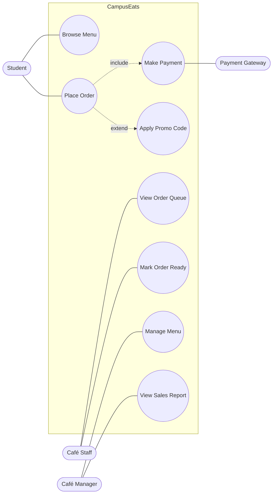
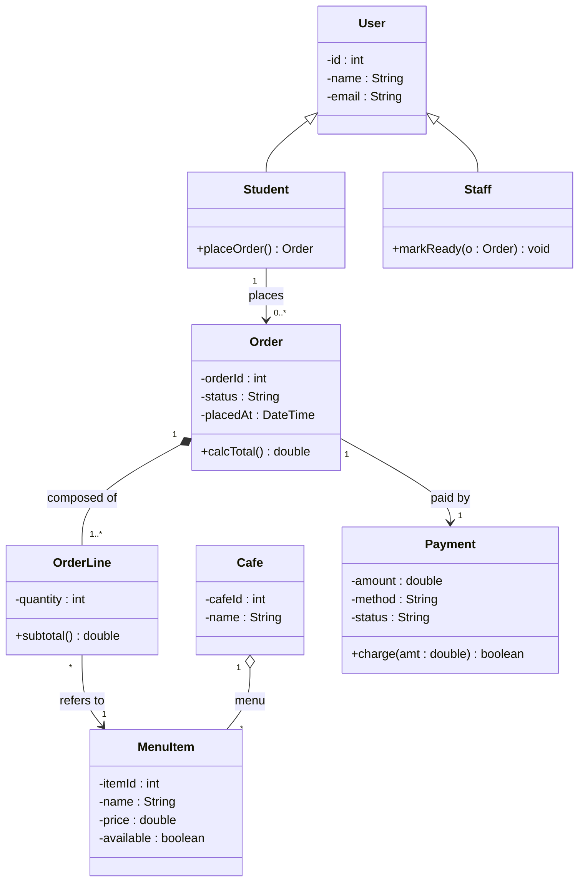
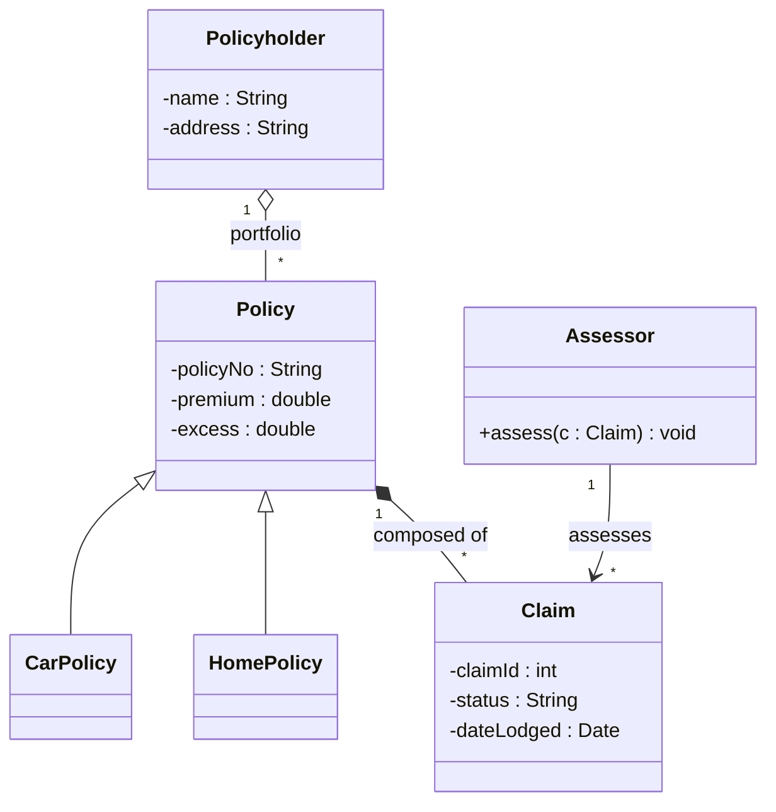
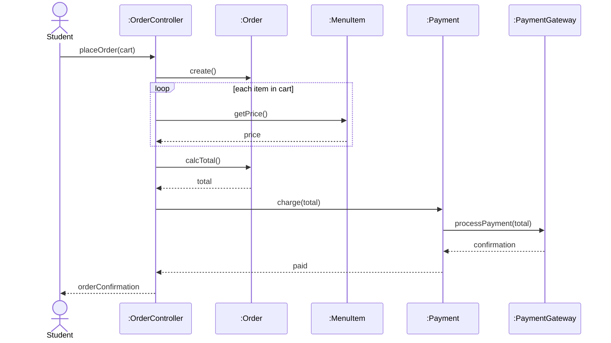
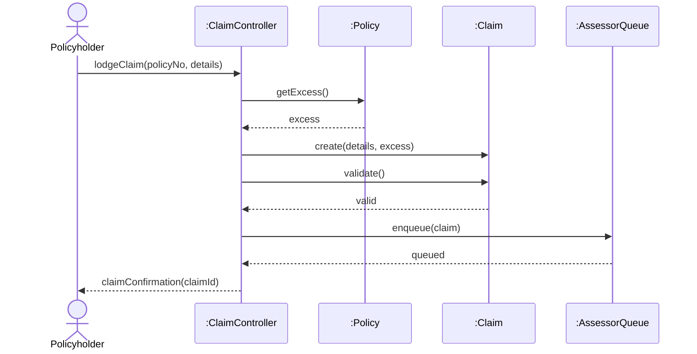

# CSIT314 — Worked Diagrams & Case Descriptions (Part B drawing practice)

Part B may ask you to **draw diagrams and write case descriptions**. This doc gives *complete, exam-ready worked examples* of the three artefacts you're most likely to be asked for:

1. **Use case descriptions** (the detailed written format)
2. **Class diagrams**
3. **Sequence diagrams**

Each uses the **notation taught in the slides** (Topic 3 for use cases/classes, Topic 4 for sequence diagrams). Examples are given on two scenarios: the mock **CampusEats** food-ordering app and the **Lab 1 "Sure Thing Insurance"** claims system. Diagrams are shown as **Mermaid** (renders automatically on GitHub) *and* as **ASCII sketches** so you can see exactly what to put on paper in the exam.

> **In a pen-and-paper exam you draw the ASCII-style version.** The Mermaid blocks are there so the rendered GitHub page shows you the finished shape.

---

## PART 1 — Use Case Descriptions

A **use case diagram** shows actors + use cases + relationships. A **use case description** is the *written* detail behind one use case. The slide format (Topic 3 p.11) uses: **Use Case name, Actor, Description, Basic Flow, Alternative Flows.** A fuller exam-grade template adds preconditions/postconditions:

### Template (memorise this skeleton)
```
Use Case:        <name>
Actor(s):        <primary actor> (+ secondary/external systems)
Description:     <one-sentence goal>
Preconditions:   <what must be true before it starts>
Basic Flow:      1. ... 2. ... 3. ...   (the main success scenario)
Alternative Flows: <branch name>: <what happens instead>
Postconditions:  <what is true after success>
```

### Example A — CampusEats: *Place Order*
```
Use Case:        Place Order
Actor(s):        Student (primary); Payment Gateway (external system)
Description:     A student selects menu items and places a paid order for pickup.
Preconditions:   Student is logged in; the café is open; cart is not empty.
Basic Flow:
  1. The student opens a café's menu and adds items to the cart.
  2. The student proceeds to checkout.
  3. The system displays the order summary and total price.
  4. The student confirms and chooses to pay (include: Make Payment).
  5. The system validates payment via the Payment Gateway.
  6. The system creates the order and places it in the café's live queue.
  7. The system shows an order confirmation with an estimated time.
Alternative Flows:
  4a. Student applies a promo code (extend: Apply Promo Code): total is recalculated.
  5a. Payment is declined: the system shows an error, order is NOT created,
      and the student may retry or cancel.
  *a. Student cancels during checkout: the cart is kept, no order is created.
Postconditions: A paid order exists with status "Queued"; café staff are notified.
```

### Example B — Sure Thing Insurance: *Lodge Car Insurance Claim*
```
Use Case:        Lodge Claim (Car)
Actor(s):        Policyholder (primary); Assessor (secondary, downstream)
Description:     A policyholder lodges an online claim against a car policy.
Preconditions:   Policyholder is authenticated and holds an active car policy.
Basic Flow:
  1. Policyholder selects the car policy to claim against.
  2. System presents the claim form and charges the excess (processing cost).
  3. Policyholder enters claim type (theft or damage), date/time, and location.
  4. For damage: policyholder describes the accident, fault, other party, conditions.
      For theft: policyholder answers locked/garaged/alarmed/steering-locked questions.
  5. Policyholder submits the claim.
  6. System records the claim and adds it to an assessor's queue.
Alternative Flows:
  2a. Driver was under 25 or licensed < 1 year: increased excess is applied.
  4a. Theft claim: system flags that a physical police report is required.
  *a. Policyholder cancels at any time before submission: no claim is lodged.
Postconditions: A claim exists with status "Lodged" and is queued for an assessor;
      the fact a claim was made is recorded for next year's premium calculation.
```

### The matching use case DIAGRAM (CampusEats)



**ASCII version (what you draw on paper):**
```
            +-------------------------- CampusEats --------------------------+
            |                                                                |
 Student ---+--( Browse Menu )                                               |
      \     |                                                                |
       \----+--( Place Order ) .....include.....> ( Make Payment )---+       |
            |         :                                              |       |
            |         `....extend....> ( Apply Promo Code )          |       |
            |                                                        |       |
 Café Staff-+--( View Order Queue )     ( Mark Order Ready )         |       |
            |                                                        |       |
 Manager ---+--( Manage Menu )          ( View Sales Report )        |       |
            |                                                        |       |
            +--------------------------------------------------------|-------+
                                                                     |
                                              Payment Gateway -------+
```
- Actor = stick figure (shown as a name on paper). Use case = ellipse. **System boundary** = the box.
- `«include»` = dashed arrow, compulsory/reused behaviour. `«extend»` = dashed arrow, optional/conditional.

---

## PART 2 — Class Diagrams

Class box = **three compartments: name / attributes / methods**. Visibility prefixes: `+` public, `-` private, `#` protected; `{read only}` constant; underline = static. Attribute `name: Type`; method `name(): ReturnType`.

**Relationships (pick the right one — this is where marks are won):**
- **Aggregation** ◇—— "is-a-part-of", parts can exist alone (hollow diamond).
- **Composition** ◆—— "is composed of", parts die with the whole (filled diamond).
- **Inheritance** ——▷ "is-a" (hollow triangle at the parent).
- **Association** —— generic "uses / has-a" (plain line, with multiplicities like `1`, `0..*`).

### Example A — CampusEats



**ASCII version (what you draw on paper):**
```
                 +------------------+
                 |      User        |
                 +------------------+
                 | - id : int       |
                 | - name : String  |
                 | - email : String |
                 +------------------+
                        /_\                 (inheritance = hollow triangle)
                   ______|______
                  |             |
          +---------------+  +---------------+
          |   Student     |  |    Staff      |
          +---------------+  +---------------+
          | +placeOrder() |  | +markReady()  |
          +---------------+  +---------------+
                 | 1
                 | places
                 v 0..*
          +------------------+   1      1..*   +------------------+
          |      Order       |◆--------------->|   OrderLine      |   (composition = filled diamond on Order)
          +------------------+  composed of     +------------------+
          | - orderId : int  |                  | - quantity : int |
          | - status : String|                  | +subtotal()      |
          | +calcTotal()     |                  +------------------+
          +------------------+                          | *
                 | 1                                    | refers to
                 | paid by                              v 1
                 v 1                            +------------------+
          +------------------+                  |    MenuItem      |
          |     Payment      |                  +------------------+
          +------------------+          1   *   | - price : double |
          | - amount : double|   Cafe ◇-------->| - available      |
          +------------------+   (aggregation)  +------------------+
```
- `Order ◆—— OrderLine`: **composition** — delete the order, its lines die.
- `Cafe ◇—— MenuItem`: **aggregation** — items belong to a menu but exist independently.
- `OrderLine —— MenuItem`: **association** — a line just references an item.
- `Student/Staff ——▷ User`: **inheritance**.

### Example B — Sure Thing Insurance (relationship-focused)



**Key modelling choices to state in your answer:**
- `Policyholder ◇—— Policy` (**aggregation**): a policyholder holds a *portfolio* of policies; a policy can exist/transfer independently.
- `Policy ◆—— Claim` (**composition**): a claim only exists in the context of its policy.
- `CarPolicy / HomePolicy ——▷ Policy` (**inheritance**): coverage types specialise a general policy (supports the "easily extendable" requirement).
- `Assessor —— Claim` (**association**): assessors process claims.

---

## PART 3 — Sequence Diagrams

Rules from the slides (Topic 4):
- Objects/classes along the **X-axis**; time increases **down the Y-axis**.
- The object that **initiates** is on the **left**; more subordinate objects to the right.
- Object label = `instance : Class` (e.g. `:OrderController`).
- **Lifeline** = dashed vertical line; an **X** marks where an object is deleted.
- **Focus of control** = narrow hollow rectangle on the lifeline while the object is active.
- **Message** = solid line with a **filled arrowhead** (named as the target's method).
- **Return** (optional) = **dashed line with an open/empty arrowhead**.
- One sequence diagram generally describes **one use case** (the class diagram is assumed done).

### Example A — CampusEats: *Place Order* (uses a B-C-E control object)



**ASCII version (what you draw on paper):**
```
 Student     :OrderController   :Order     :MenuItem    :Payment   :PaymentGateway
   |               |              |            |            |            |
   |-placeOrder()->|              |            |            |            |
   |              |##|            |            |            |            |     (## = focus of control bar)
   |               |--create()--->|            |            |            |
   |               |            |##|           |            |            |
   |               |----getPrice()------------>|            |            |   (loop per item)
   |               |<- - - - - price - - - - - -|            |            |   (dashed = return)
   |               |--calcTotal()->|            |            |            |
   |               |<- - total - - |            |            |            |
   |               |--charge(total)------------------------>|            |
   |               |            |              |          |##|           |
   |               |            |              |            |-processPayment()->|
   |               |            |              |            |<- - confirmation -|
   |               |<- - - - - - - - paid - - - - - - - - - |            |
   |<- - orderConfirmation - - -|              |            |            |
   |               |              |            |            |            |
```
- Solid arrow `--->` = call (method of the receiver). Dashed arrow `<- -` = return value.
- The vertical dashed lines are **lifelines**; the `##` blocks are **focus of control**.
- `Student` initiates, so it's on the **left**; the external `PaymentGateway` is furthest right.

### Example B — Sure Thing Insurance: *Lodge Claim* (shows object creation + deletion)



**Notes to earn marks:**
- `create(...)` is shown as a message that **creates** the `:Claim` object (its lifeline starts there).
- If the policyholder *cancels*, you'd show an **X** on the `:Claim` lifeline (object deleted).
- `:ClaimController` is the **control** class implementing this one use case (B-C-E) — exactly the "glue" role from Topic 4.

---

## Exam drawing checklist (quick self-check)

**Use case diagram/description**
- [ ] Actors outside the boundary box; use cases inside.
- [ ] `«include»` for compulsory/reused, `«extend»` for optional/conditional.
- [ ] Description has Actor, Basic Flow, and at least one Alternative Flow.

**Class diagram**
- [ ] Three compartments; visibility prefixes on attributes/methods.
- [ ] Correct relationship symbol: composition (filled ◆) vs aggregation (hollow ◇) vs inheritance (▷) vs association (plain line).
- [ ] Multiplicities on associations (`1`, `0..*`, `1..*`).

**Sequence diagram**
- [ ] One use case; initiator on the left.
- [ ] `instance:Class` labels; lifelines; focus-of-control bars.
- [ ] Solid filled arrow for calls, dashed open arrow for returns.
- [ ] Consistent with the class diagram (messages = methods that exist on the receiver's class).

> **Consistency is marked:** your use case → class diagram → sequence diagram should line up (Lab 3 explicitly required all diagrams be consistent with each other and the code).

---

## Sources & Citations
| Artefact | Convention taught on | Source |
|---|---|---|
| Use case description format (Actor / Basic Flow / Alternative Flows) | User Authentication example | *UOW 2016 Topic 3.pdf* p.11 |
| Use case diagram: boundary box, actor:use-case multiplicities | | *Topic 3.pdf* p.12 |
| «include» (compulsory) / «extend» (optional, conditional) | | *Topic 3.pdf* pp.13–14 |
| Class symbol, 3 compartments, visibility prefixes | | *Topic 3.pdf* pp.16–17 |
| Aggregation / composition / inheritance / association | | *Topic 3.pdf* pp.19–21 |
| Sequence diagram: X=objects, Y=time, initiator on left | | *Topic 4.pdf* pp.4–6 |
| Lifeline, X=deletion, focus of control, filled-arrow message, dashed-arrow return | | *Topic 4.pdf* pp.8–11 |
| Worked example (ATM: use case → class → sequence) | | *Topic 4.pdf* p.12 |
| B-C-E control object as the per-use-case coordinator | | *Topic 4.pdf* pp.14–21 |
| Keeping all diagrams consistent with each other & code | | *Lab 3.pdf* Task 1 |

*Legend: Topic N = "UOW 2016 Topic N.pdf". The CampusEats scenario is a mock for practice; Sure Thing Insurance is from Lab 1.pdf.*
