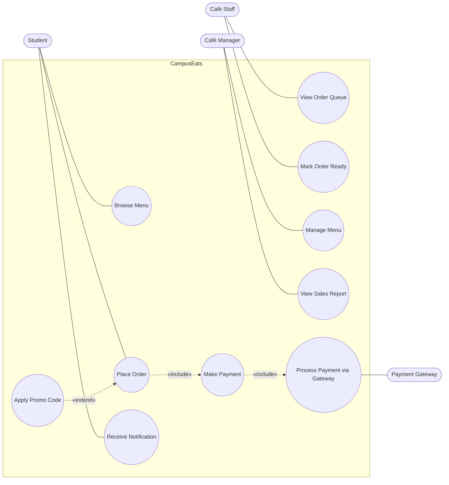
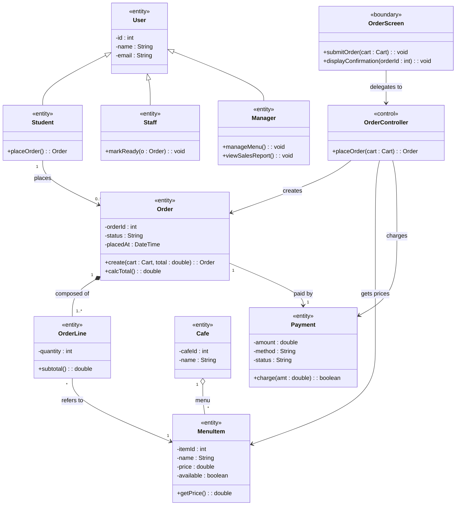
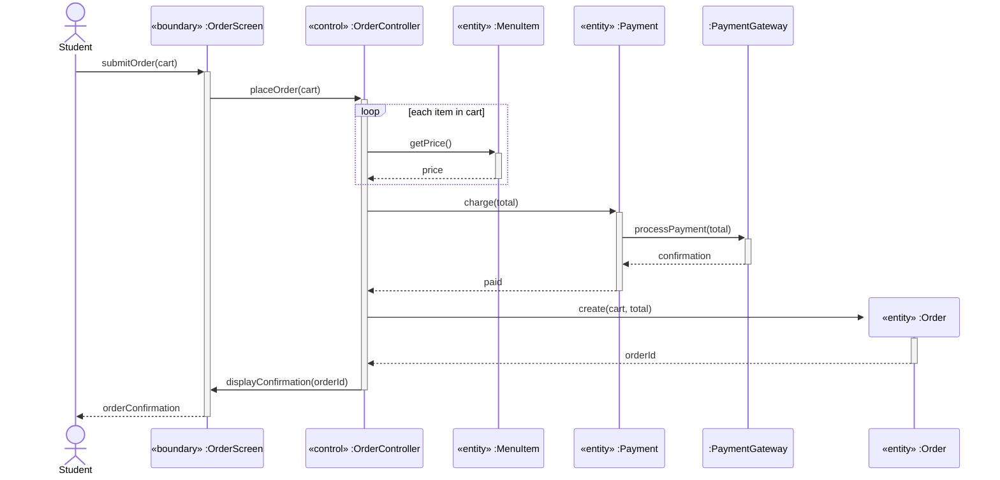

# CSIT314 — Part B Practice: Worked Scenario Answers

**Format reminder:** Part B = 7 questions on a project scenario, 40 marks. You *apply* concepts: write user stories, draw/describe UML, recommend a process, design a testing approach, write test cases, and justify your choices.

Below is a **mock scenario** followed by **model answers to seven questions** in the style the exam uses, plus a short note on *why* each answer earns marks. Use it as a template: practise producing the same kinds of artefact for the Lab 1 "Sure Thing Insurance" scenario.

---

## Mock Scenario — "CampusEats" Food-Ordering System

> *CampusEats* is a new web and mobile app that lets university students order food from on-campus cafés for pickup. A **student** browses menus, adds items to a cart, and pays online as part of placing an order. When an order is placed, the relevant **café staff** member sees it in a live queue, prepares it, and marks it *ready*; the student is notified to collect it. A **café manager** maintains the menu (adding/removing items and prices) and views daily sales reports. Payment is handled by an external **payment gateway**. The university wants a first release covering only café pickup orders, but delivery is planned later, so the design must be easily extendable. Requirements are still evolving and the client wants to see working software early and often.

---

## Q1 (5 marks) — Write user stories

Using the template **"As a `<user>`, I want `<goal>` so that `<reason>`":**

1. *As a student, I want to browse a café's menu so that I can decide what to order.*
2. *As a student, I want to add items to a cart and place an order so that I can buy food for pickup.*
3. *As a student, I want to pay online so that my order is confirmed without handling cash.*
4. *As a student, I want to be notified when my order is ready so that I can collect it promptly.*
5. *As café staff, I want to see incoming orders in a live queue so that I can prepare them in order.*
6. *As café staff, I want to mark an order as ready so that the student is notified to collect it.*
7. *As a café manager, I want to add, edit, and remove menu items and prices so that the menu stays current.*
8. *As a café manager, I want to view a daily sales report so that I can track revenue.*

> **Why it scores:** correct template; stories are small, user-focused, and cover **all three actors** plus distinct goals. Each has a genuine *reason*, not a restated goal.

---

## Q2 (5 marks) — Use case diagram (describe)

**Actors:** Student, Café Staff, Café Manager, Payment Gateway (external system).
**System boundary box:** "CampusEats".

**Use cases and associations:**
- Student → *Browse Menu*, *Place Order*, *Receive Notification*.
- Café Staff → *View Order Queue*, *Mark Order Ready*.
- Café Manager → *Manage Menu*, *View Sales Report*.
- *Place Order* → **«include»** → *Make Payment* (every order must be paid).
- *Make Payment* → **«include»** → *Process Payment via Gateway*; the Payment Gateway actor participates in this included use case.
- *Apply Promo Code* → **«extend»** → *Place Order* (optional, only when the student has a code).

**Diagram answer:**

> **How to read it:** the dashed `«include»` arrows represent compulsory behaviour. The dashed `«extend»` arrow starts at *Apply Promo Code* and points to its base use case, *Place Order*, because applying a code is optional.

> **Why it scores:** actors + boundary + correct use of **«include»** (compulsory/reused) vs **«extend»** (optional/conditional), and the external system modelled as an actor.

---

## Q3 (6 marks) — Class diagram (describe, with relationships)

**Classes (with sample attributes/methods):**
- `Student` — **`«entity»`**: `- id:int`, `- name:String`, `- email:String`, `+ placeOrder():Order`
- `Order` — **`«entity»`**: `- orderId:int`, `- status:String`, `- placedAt:DateTime`, `+ create(cart:Cart, total:double):Order`, `+ calcTotal():double`
- `OrderLine` — **`«entity»`**: `- quantity:int`, `+ subtotal():double`
- `MenuItem` — **`«entity»`**: `- itemId:int`, `- name:String`, `- price:double`, `- available:boolean`, `+ getPrice():double`
- `Cafe` — **`«entity»`**: `- cafeId:int`, `- name:String`
- `Payment` — **`«entity»`**: `- amount:double`, `- method:String`, `- status:String`, `+ charge(amt:double):boolean`
- `OrderScreen` — **`«boundary»`**: `+ submitOrder(cart):void`, `+ displayConfirmation(orderId:int):void` (actor-facing UI)
- `OrderController` — **`«control»`**: `+ placeOrder(cart):Order` (coordinates this use case)
- `Manager` and `Staff` — specialised users.

**Relationships (choose the right one — this is where marks are won/lost):**
- `Order` **composition** `OrderLine` — an order line cannot exist without its order (destroy the order → destroy its lines). Filled diamond at `Order`.
- `OrderLine` **association** `MenuItem` — a line *refers to* a menu item (the item exists independently). Plain line, multiplicity 1.
- `Cafe` **aggregation** `MenuItem` — a menu item *is part of* a café's menu but can exist independently (e.g. shared/reused items). Hollow diamond at `Cafe`.
- `Student` **association** `Order` (1 → 0..*) — a student places many orders.
- `OrderScreen` **association** `OrderController` — the **`«boundary»`** forwards the student's request to the **`«control»`**.
- `OrderController` **association** `Order`, `MenuItem`, and `Payment` — the **`«control»`** coordinates these **`«entity»`** classes and service for this use case.
- `Staff` and `Manager` **inheritance** from a general `User` superclass — "is-a".

**Diagram answer:**

> **How to read it:** `<<boundary>>` handles actor interaction, `<<control>>` coordinates this use case, and `<<entity>>` holds business-domain data. Filled diamond = composition; hollow diamond = aggregation; hollow triangle = inheritance.

> **Why it scores:** correct notation (visibility prefixes, multiplicities) and — crucially — **justified** relationship types: composition vs aggregation vs association vs inheritance, each matched to the scenario's facts.

---

## Q4 (5 marks) — Sequence diagram for *Place Order* (describe)

One sequence diagram per use case. Objects left→right (initiator on the left):
`:Student` → `«boundary» :OrderScreen` → `«control» :OrderController` → `«entity» :MenuItem` / `«entity» :Payment` → `:PaymentGateway` → `«entity» :Order`

Message flow (top→bottom = time):
1. `Student` → `«boundary» :OrderScreen` : `submitOrder(cart)`
2. `«boundary» :OrderScreen` → `«control» :OrderController` : `placeOrder(cart)`
3. loop for each cart item: `«control» :OrderController` → `«entity» :MenuItem` : `getPrice()` → *return price* (dashed arrow)
4. `«control» :OrderController` → `«entity» :Payment` : `charge(total)`
5. `«entity» :Payment` → `PaymentGateway` : `processPayment(total)` → *return confirmation*
6. On successful payment, `«control» :OrderController` → `«entity» :Order` : `create(cart, total)`
7. `«control» :OrderController` → `«boundary» :OrderScreen` : `displayConfirmation(orderId)` → *return confirmation to Student*

Notation: activation bars (focus of control) over each lifeline while active; solid filled arrows for calls, dashed open arrows for returns.

**Diagram answer:**

> **How to read it:** the activation bars are created by `->>+` and closed by `-->>-` (or `deactivate`). A solid arrow remains a method call even when it points left, so `OrderController → OrderScreen : displayConfirmation(...)` is solid. The final dashed arrow returns the result of the student's original `submitOrder(...)` call.

> **Why it scores:** models **one** use case; initiator on the left; correctly applies **B-C-E** (the actor calls a Boundary class, which delegates to the Control); correct call/return arrows; interaction with the external gateway shown. Each **internal** receiver has a matching operation in the class diagram.

---

## Q5 (6 marks) — Recommend a process model / methodology (justify)

**Recommendation: an Agile approach — Scrum with XP engineering practices — delivered incrementally/iteratively.**

Justification tied to the scenario:
- Requirements are **still evolving** and the client wants **working software early and often** → rules out Waterfall (which needs stable, well-understood requirements up front).
- **Incremental/iterative** delivery lets CampusEats ship café-pickup ordering first and add **delivery** later — matching the "must be easily extendable / delivery planned later" constraint, and giving students usable value early.
- **Scrum** provides a Product Owner to prioritise the backlog as requirements change, short sprints for frequent feedback, and a burndown to track progress.
- **XP practices** (TDD, continuous integration, small releases, refactoring) keep quality high while the product changes rapidly.

> **Why it scores:** picks a model **and** justifies it against specific scenario facts (evolving requirements, early delivery, extensibility), explicitly contrasting it with a rejected alternative (Waterfall).

---

## Q6 (7 marks) — Design a testing approach (justify)

A layered V&V approach:
1. **Static verification first** — inspect requirements/user stories and the class/sequence diagrams before coding (catches defects early and cheaply, and covers hard-to-test concerns).
2. **Unit testing (automated, white-box)** — test individual methods such as `Order.calcTotal()` and `OrderLine.subtotal()` in isolation with JUnit; use statement/branch coverage. Practise **TDD** (write tests first) per the chosen XP approach.
3. **Integration testing** — test interactions, focusing on **interfaces**: e.g. `OrderController` ↔ `Payment` ↔ external `PaymentGateway`. Use a stub/mock for the gateway so tests don't hit the real payment service.
4. **System testing** — function tests (place-order end to end), performance tests (order queue under load — a non-functional requirement), and **acceptance testing** derived from the user stories before handover.
5. **Black-box techniques** for inputs such as cart quantity: **equivalence partitioning** (valid 1–n, invalid 0, invalid negative) + **boundary value analysis** (0, 1, max, max+1).
6. Run all automated tests on every commit via **CI** so regressions are caught immediately.

> **Why it scores:** names the **levels** in order, matches **white/black-box** techniques to concrete scenario elements, mentions **V&V** (static + dynamic), and links testing to CI/TDD.

---

## Q7 (6 marks) — Write test cases

Using the standard 8-column matrix for the *Make Payment* feature:

| Case ID | Scenario | Steps | Prerequisites | Test Data | Expected Result | Actual | Status |
|---|---|---|---|---|---|---|---|
| CE-PAY-01 | Successful card payment | 1. Place order; 2. Choose card; 3. Enter valid details; 4. Confirm | Logged-in student; valid items in cart | Valid card, amount = $12.50 | Payment approved; order status → *Paid*; confirmation shown | *(as expected)* | *Pass* |
| CE-PAY-02 | Declined card | 1–4 as above | Logged-in student; valid items in cart | Card flagged "insufficient funds", amount = $12.50 | Payment rejected; clear error message; cart remains available to retry; **no order is created** and no stock is committed | | |
| CE-PAY-03 | Invalid cart quantity (boundary) | 1. Set item quantity; 2. Attempt checkout | Menu item available | quantity = 0 | Validation error "quantity must be at least 1"; checkout blocked | | |
| CE-CART-04 | Boundary max quantity | 1. Set quantity to max allowed (e.g. 10); 2. Checkout | Item available, stock ≥ 10 | quantity = 10 | Order accepted; total = 10 × price | | |
| CE-CART-05 | Over-max quantity (boundary+1) | 1. Set quantity 11; 2. Checkout | Item available | quantity = 11 | Error "maximum 10 per item"; checkout blocked | | |

> **Why it scores:** each case is uniquely IDed with a clear purpose, concrete **test data**, and explicit **expected results**; includes both a **normal** case and **abnormal/boundary** cases (equivalence partitioning + boundary value analysis in action).

---

## How to practise with this template
Re-do all seven questions for the **Lab 1 "Sure Thing Insurance" online-claims** scenario:
- Actors there: **policyholder, assessor, investigator**.
- Rich relationship material: a *portfolio* of *policies* (aggregation), a *claim* belonging to a policy (composition), third-party / fire-theft / comprehensive coverage (inheritance).
- Testing targets: premium calculation, excess/no-claim-bonus rules, the two-week stolen-car wait — ideal for equivalence partitioning and boundary value analysis.

Writing out your own answers (not just reading these) is what builds Part B speed.

---

# Independent Practice Sets

These scenarios are deliberately **questions only**. Attempt each under exam conditions before comparing your approach with the CampusEats worked examples above. Each set has seven questions and targets the same skills as Part B.

## Practice Set 1 — UniLibrary Lending System

> **Scenario:** UniLibrary wants a web system for students and staff to search its catalogue and manage loans. A **member** can search by title, author, or ISBN, view a book's availability, borrow an available physical copy at the library desk, return a copy, and renew an existing loan. A member may have at most **10 active loans**. A standard loan lasts **14 days**. If every copy is on loan, a member may place a hold; when a copy is returned, the first member in the hold queue is notified. A **librarian** adds books and copies to the catalogue and records lost copies. The university expects the first release to cover physical book loans; e-book lending may be added later. Requirements may change after feedback from students and library staff.

### Q1 (5 marks) — User stories
Write **five** user stories using the template *As a `<type of user>`, I want `<goal>` so that `<reason>`.* Cover both Member and Librarian.

### Q2 (5 marks) — Use case description and use case diagram
For the **Borrow Copy** use case:

1. Write a use case description containing **Actor(s), Description, Preconditions, Basic Flow, Alternative Flows, and Postconditions**.
2. Draw a use case diagram for UniLibrary. Include Member and Librarian, the system boundary, and the main use cases.
3. Use `«include»` or `«extend»` where justified. State in one sentence why each relationship is include or extend.

### Q3 (6 marks) — Class diagram with B-C-E
Draw a class diagram for **Borrow Copy**. Include suitable `«boundary»`, `«control»`, and `«entity»` classes; attributes, operations, multiplicities, and relationships.

Your diagram should consider at least: `Member`, `Book`, `BookCopy`, `Loan`, `Hold`, a Boundary class, and a Control class. Show and justify whether a `Book`–`BookCopy` relationship is association, aggregation, or composition.

### Q4 (5 marks) — Sequence diagram
Draw a sequence diagram for **Borrow Copy** using the classes from Q3. Include:

- Member → `«boundary»` → `«control»` interaction.
- A check that the member has fewer than 10 active loans.
- A check that the selected copy is available.
- Creation of the loan and the change of the copy's status to *On loan*.
- Activation bars, solid call arrows, and dashed return arrows where appropriate.

### Q5 (5 marks) — State diagram
Draw a state diagram for one `BookCopy`. Use at least these states: **Available**, **On loan**, **On hold**, and **Lost**. Label each transition with a relevant event, and add a guard condition where it helps.

### Q6 (6 marks) — Process recommendation
Recommend a software process/model for UniLibrary and justify it using **three facts** from the scenario. Compare your choice with one model that would be less suitable.

### Q7 (8 marks) — Testing approach and test cases
1. Propose a layered testing approach using static verification, unit testing, integration testing, system testing, and acceptance testing.
2. Create a test-case matrix with at least **four test cases** for borrowing and renewing loans. Include one normal case, one **equivalence-partition** case, and at least two **boundary-value** cases for the maximum-loan or loan-duration rules.

---

## Practice Set 2 — EventHub Booking System

> **Scenario:** EventHub is a web and mobile system for university clubs to publish events and for students to reserve tickets. An **attendee** can browse events, select a ticket type, reserve a ticket, pay online, receive a booking confirmation, and cancel a booking before the event begins. An **organiser** creates events, defines ticket types and prices, sets capacity, and checks attendee lists. An event may have multiple ticket types, such as Student and General Admission. A reservation is confirmed only after a successful payment. If an event is full, an attendee can join a waiting list; when a booking is cancelled, the first waiting attendee is offered a ticket. Payments use an external **Payment Gateway**. The team needs to release a small useful version early, expects event requirements to change, and wants every accepted change to be built and tested automatically.

### Q1 (5 marks) — User stories
Write **five** user stories covering at least one Attendee goal, one Organiser goal, online payment, cancellation, and the waiting list.

### Q2 (5 marks) — Use case diagram and relationships
Draw a use case diagram for EventHub. Include Attendee, Organiser, and the external Payment Gateway. Include at least six use cases, and show:

- `Reserve Ticket` **including** payment processing.
- The Payment Gateway interacting with the payment-processing use case.
- `Join Waiting List` as an appropriate optional/conditional extension or explain why you chose a different relationship.

### Q3 (6 marks) — Class diagram with B-C-E
Draw a class diagram for **Reserve Ticket**. Include B-C-E stereotypes, suitable attributes/methods, multiplicities, and relationships for at least `Attendee`, `Event`, `TicketType`, `Reservation`, `Payment`, a Boundary class, and a Control class.

Explain why `Event`–`TicketType` and `Reservation`–`Payment` use your chosen relationship types.

### Q4 (5 marks) — Sequence diagram
Draw a sequence diagram for **Reserve Ticket**. Include:

- Actor → `«boundary»` → `«control»` → `«entity»` flow.
- Capacity validation.
- Payment sent to the external gateway.
- Reservation creation **only after successful payment**.
- A returned booking confirmation and activation bars.

### Q5 (5 marks) — Alternative flow / use case description
Write an alternative flow for **payment declined** and one for **event full** in a *Reserve Ticket* use case description. State the postcondition for each alternative.

### Q6 (6 marks) — CI/CD and DevOps practice
Describe a CI/CD and DevOps approach for EventHub. Include a single source repository, automated build/test feedback, staging, the difference between continuous delivery and continuous deployment, and one production-monitoring responsibility.

### Q7 (8 marks) — Test design
Create a test-case matrix with at least **four** cases for Reserve Ticket. Include:

- successful payment with remaining capacity;
- a declined payment;
- a capacity boundary case for the final available ticket;
- an over-capacity case that places the attendee on the waiting list.

For each case, give concrete preconditions, test data, and expected results.

---

## How to self-mark

Use the CampusEats worked answers as a checklist, not a script:

- **Use cases:** actors outside the system boundary; `«include»` is compulsory; `«extend»` is optional/conditional and points from the extension to the base use case.
- **Class diagrams:** model only the classes needed by the selected user story/use case; label B-C-E design classes; use multiplicities and justified relationships.
- **Sequence diagrams:** draw one use case; actor → Boundary → Control → Entity; include activation bars, calls, returns, and only operations that exist in your class diagram.
- **Test cases:** include an ID, steps, prerequisites, test data, expected results, and normal plus invalid/boundary inputs.

---

## Sources & Citations
These questions apply concepts taught on the following slides and labs. ("T4 pp.14–21" = `UOW 2016 Topic 4.pdf`, pages 14–21.)

| Concept / relevant questions | Source |
|---|---|
| User-story template — CampusEats Q1; independent Sets 1–2 Q1 | *T2 p.15*; *Lab 1* pp.1–3 |
| Use case description, actors, boundary, `«include»`, `«extend»` — CampusEats Q2; independent Sets 1–2 Q2 and Set 2 Q5 | *T3 pp.6–14* |
| Class symbols/prefixes, relationships, B-C-E — CampusEats Q3; independent Sets 1–2 Q3 | *T3 pp.16–21*; *T4 pp.14–21* |
| Sequence diagrams, lifelines, activation bars, call/return messages — CampusEats Q4; independent Sets 1–2 Q4 | *T4 pp.4–11* |
| State diagrams — independent Set 1 Q5 | *T3 pp.28–30*; *Lab 3* pp.1–2 |
| Process-model choice — CampusEats Q5; independent Set 1 Q6 | *T2 pp.4–10, 24–35*; *T8 (XP)* pp.16–27 |
| CI/CD and DevOps — independent Set 2 Q6 | *T6 pp.17–21, 32–35*; *T7 pp.10–15* |
| V&V/test levels, black-box techniques, and test-case matrices — CampusEats Q6–Q7; independent Set 1 Q7 and Set 2 Q7 | *T5 pp.3–29* |

> **Legend:** T1–T12 = `UOW 2016 Topic 1–12.pdf`; Lab 1/3/5/7 = the matching `Lab N.pdf`. Full file↔page lookup is in `EXAM-STUDY-GUIDE.md` → *Sources & Citations*. **CampusEats, UniLibrary, and EventHub are mock scenarios written for practice**; the Sure Thing Insurance scenario is from *Lab 1.pdf* pp.1–3.
