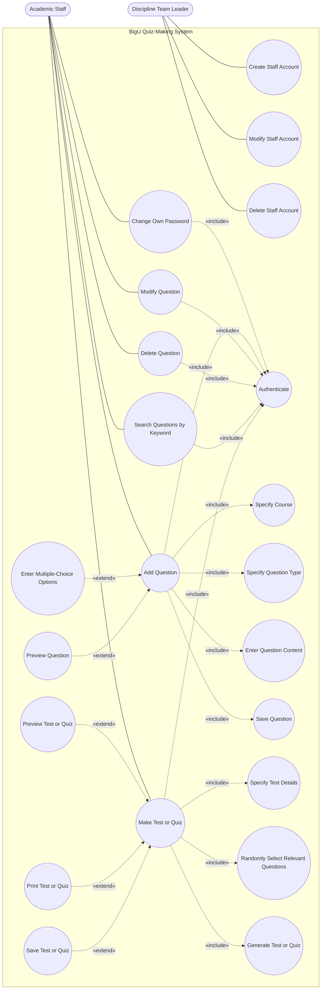
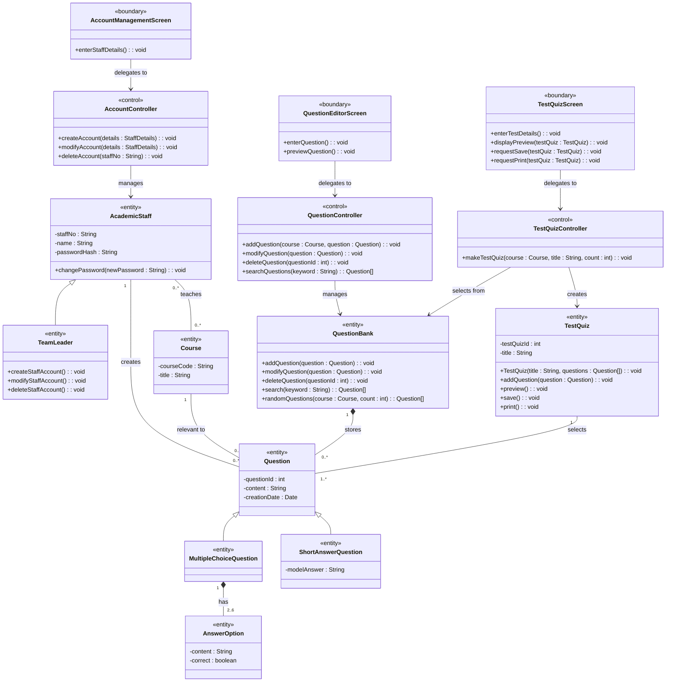
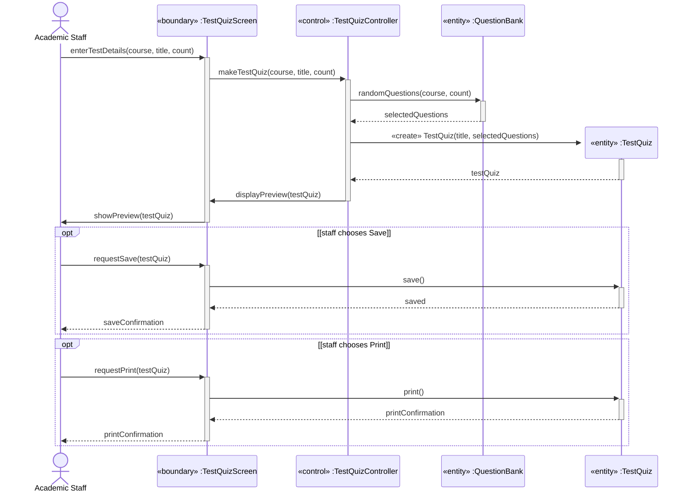

# CSIT314 2020 Past Paper — Worked Answers

> **Scope:** These worked answers respond to the two questions in the images provided: the **BigU quiz-making system** question and the **test-driven development** question. They are study material, not official marking answers. Design names such as `QuizController` are deliberate modelling choices derived from the case study; different clear, consistent names could also earn marks.

---

# Question 1 — BigU Quiz-Making System

## (a) User stories

1. **As a Discipline Team Leader, I want to create an academic staff account with staff number, name, courses taught, and an initial password so that staff can use the quiz-making system.**
2. **As a Discipline Team Leader, I want to modify an academic staff account so that staff details and course assignments remain current.**
3. **As a Discipline Team Leader, I want to delete an academic staff account so that former staff cannot access the system.**
4. **As an academic staff member, I want to change only my own password so that I can keep my account secure.**
5. **As an academic staff member, I want to log in so that I can access authorised question-bank and quiz-making functions.**
6. **As an academic staff member, I want to add a question for one of my courses so that the question bank grows.**
7. **As an academic staff member, I want to create either a multiple-choice or short-answer question so that I can assess students using the appropriate question type.**
8. **As an academic staff member, I want to enter two to six answer options and identify exactly one correct option for a multiple-choice question so that it can be marked correctly.**
9. **As an academic staff member, I want to preview a new question before saving it so that I can check its content.**
10. **As an academic staff member, I want to search the question bank by keyword so that I can find an existing question quickly.**
11. **As an academic staff member, I want to modify or delete my existing questions so that the question bank remains accurate.**
12. **As an academic staff member, I want to generate a test or quiz by choosing a subject, title, and number of questions so that I can prepare an assessment efficiently.**
13. **As an academic staff member, I want the system to randomly select questions relevant to the chosen subject so that the generated test is varied and valid for that subject.**
14. **As an academic staff member, I want to preview, print, or save a generated test or quiz so that I can review and distribute it.**

> **Why this answers the case:** The stories cover the two primary actors, account management, password restriction, question-bank management, both supported question types, keyword search, and the full test/quiz-generation flow.

---

## (b) UML use case diagram

### Actors

- **Academic Staff**
- **Discipline Team Leader**

### Relationship choices

- `«include» Authenticate` is used for protected staff functions because authentication is compulsory before they can be performed.
- `«include» Randomly Select Relevant Questions` is used by test/quiz generation because the scenario says the system performs this selection.
- `«extend» Preview Question` and `«extend» Preview Test/Quiz` are used because previewing is optional.
- `«extend» Print Test/Quiz` and `«extend» Save Test/Quiz` are used because the staff member may choose either, both, or neither after previewing.



> **Exam note:** In a handwritten UML use case diagram, draw actors as stick figures and use cases as ellipses inside the BigU system boundary. `«include»` and `«extend»` are dashed arrows. An `«extend»` arrow points from the optional extension to its base use case.

---

## (c) Use case description — Make Test/Quiz

```text
Use Case:        Make Test/Quiz
Primary Actor:   Academic Staff
Description:     The staff member generates a test or quiz from questions in the
                 bank that are relevant to a selected subject.
Preconditions:   The staff member is authenticated. The selected subject exists.

Basic Flow:
  1. The staff member chooses Make Test/Quiz.
  2. The system asks for the subject, test/quiz title, and required number of questions.
  3. The staff member enters those details.
  4. The system validates the details.
  5. The system randomly selects the requested number of questions from the bank that
     are relevant to the selected subject.
  6. The system generates the test/quiz.
  7. The system displays a preview of the generated test/quiz.
  8. The staff member may print it, save it, or both.

Alternative Flows:
  4a. The number of questions is zero or negative: the system shows an error and asks
      the staff member to enter a positive number.
  5a. The bank has fewer relevant questions than requested: the system informs the
      staff member and asks for a smaller number or a different subject.
  8a. The staff member cancels after previewing: no saved test/quiz is created.

Postconditions: A generated test/quiz is available for preview. If the staff member
                chooses Save, it is stored; if they choose Print, it is sent for printing.
```

---

## (d) B-C-E class diagram

**Scope:** The diagram models the primary information and the B-C-E design needed for account management, question-bank management, and generating a test/quiz. It focuses on the *Make Test/Quiz* use case for the controller methods and later sequence diagram.



### Key design decisions

- `Question` is an abstract generalisation for the two supported types: `MultipleChoiceQuestion` and `ShortAnswerQuestion`. `ShortAnswerQuestion.modelAnswer` represents its designed answer.
- A `MultipleChoiceQuestion` has **2..6** `AnswerOption` objects, matching the case study. The business rule “exactly one correct answer” belongs in validation logic, such as `QuestionController` or a question-validation method.
- `TestQuiz -- Question` is an **association**, not composition: selected questions remain in the question bank after a test/quiz is generated.
- `QuestionBank ◆── Question` is **composition** in this design because the bank owns and manages its stored questions.
- `AccountManagementScreen`, `QuestionEditorScreen`, and `TestQuizScreen` are **`«boundary»`** classes; the controller classes coordinate the use cases; domain information is in **`«entity»`** classes.

---

## (e) Sequence diagram — Make Test/Quiz



### Why this sequence earns marks

- It models **one use case**, Make Test/Quiz.
- It starts with the actor and follows **`«boundary» → «control» → «entity»`**.
- The controller calls `QuestionBank.randomQuestions(course, count)`, which directly implements the scenario’s random relevant-question rule.
- `TestQuiz` is created only after the bank returns the selected questions.
- The diagram uses activation bars, solid calls, dashed returns, and optional (`opt`) save/print fragments.

---

# Question 2 — Test-Driven Development

## Assumptions and design choices

The case study does **not** specify an AUD→SGD exchange rate. Therefore the conversion operation accepts a **rate parameter**. This makes the method deterministic and testable; it does not hard-code a potentially outdated real-world rate.

- `audAmount` must be zero or positive.
- `sgdPerAud` must be greater than zero.
- `x` and `y` must each be in the inclusive range **−10 to 10**.
- Distance is measured in kilometres and time in hours; time must be greater than zero.
- Currency results are rounded to two decimal places using `HALF_UP`.

## TDD approach for this case

For **each small behaviour**, follow this cycle:

1. Write one failing JUnit test for the specified behaviour.
2. Run the full test suite and confirm the new test fails (**red**).
3. Implement the smallest amount of production code required to pass it (**green**).
4. Run the full test suite again.
5. Refactor only while all tests still pass.

A suitable Java implementation, after the tests are written, is:

```java
import java.math.BigDecimal;
import java.math.RoundingMode;

public final class CalculationService {
    public BigDecimal audToSgd(BigDecimal audAmount, BigDecimal sgdPerAud) {
        if (audAmount == null || sgdPerAud == null
                || audAmount.signum() < 0 || sgdPerAud.signum() <= 0) {
            throw new IllegalArgumentException("Amount must be non-negative and rate positive");
        }
        return audAmount.multiply(sgdPerAud).setScale(2, RoundingMode.HALF_UP);
    }

    public int sumOfSquares(int x, int y) {
        if (x < -10 || x > 10 || y < -10 || y > 10) {
            throw new IllegalArgumentException("x and y must be in [-10, 10]");
        }
        return x * x + y * y;
    }

    public double averageSpeed(double distanceKm, double timeHours) {
        if (distanceKm < 0 || timeHours <= 0) {
            throw new IllegalArgumentException("Distance must be non-negative and time positive");
        }
        return distanceKm / timeHours;
    }
}
```

> **TDD order example:** Start with `audToSgd(100.00, 1.10) = 110.00`. Create the method with a temporary result so the test fails, then implement multiplication. Add the zero, rounding, and invalid-input tests one at a time, implementing only the validation/rounding needed after each failure. Repeat the same red→green→refactor approach for `sumOfSquares` and `averageSpeed`.

## (a) AUD to SGD — five unit tests

Assume `sgdPerAud = 1.10` unless the row says otherwise.

| Test | Inputs | Expected result | Why this test is needed |
|---|---|---|---|
| Normal conversion | `100.00 AUD`, `1.10` | `110.00 SGD` | Typical valid amount; proves the basic multiplication. |
| Zero amount | `0.00 AUD`, `1.10` | `0.00 SGD` | Valid lower boundary for a non-negative amount. |
| Decimal amount | `12.34 AUD`, `1.10` | `13.57 SGD` | Verifies decimal multiplication and two-decimal rounding. |
| Rounding edge | `1.005 AUD`, `1.00` | `1.01 SGD` | Verifies the stated `HALF_UP` currency-rounding rule. |
| Invalid negative amount | `-1.00 AUD`, `1.10` | `IllegalArgumentException` | Invalid equivalence partition: a money amount cannot be negative. |

Example JUnit 5 tests:

```java
import static org.junit.jupiter.api.Assertions.*;
import java.math.BigDecimal;
import org.junit.jupiter.api.Test;

class CalculationServiceTest {
    private final CalculationService service = new CalculationService();

    @Test
    void convertsTypicalAudAmountToSgd() {
        assertEquals(new BigDecimal("110.00"),
                service.audToSgd(new BigDecimal("100.00"), new BigDecimal("1.10")));
    }

    @Test
    void convertsZeroAudToZeroSgd() {
        assertEquals(new BigDecimal("0.00"),
                service.audToSgd(new BigDecimal("0.00"), new BigDecimal("1.10")));
    }

    @Test
    void roundsDecimalCurrencyHalfUp() {
        assertEquals(new BigDecimal("13.57"),
                service.audToSgd(new BigDecimal("12.34"), new BigDecimal("1.10")));
    }

    @Test
    void roundsHalfCentUp() {
        assertEquals(new BigDecimal("1.01"),
                service.audToSgd(new BigDecimal("1.005"), new BigDecimal("1.00")));
    }

    @Test
    void rejectsNegativeAudAmount() {
        assertThrows(IllegalArgumentException.class,
                () -> service.audToSgd(new BigDecimal("-1.00"), new BigDecimal("1.10")));
    }
}
```

## (b) Sum of squares — five unit tests

| Test | Inputs | Expected result | Why this test is needed |
|---|---|---|---|
| Typical positive values | `x=3`, `y=4` | `25` | Verifies the stated formula: `3² + 4²`. |
| Both values zero | `x=0`, `y=0` | `0` | Tests the centre of the valid input range. |
| Mixed-sign values | `x=-3`, `y=4` | `25` | A negative value becomes positive when squared. |
| Inclusive boundaries | `x=-10`, `y=10` | `200` | Tests both valid range limits: `100 + 100`. |
| Outside boundary | `x=11`, `y=0` | `IllegalArgumentException` | Tests the invalid partition just above the permitted upper limit. |

Example JUnit 5 tests:

```java
@Test
void sumsSquaresForTypicalPositiveValues() {
    assertEquals(25, service.sumOfSquares(3, 4));
}

@Test
void sumsSquaresForZeroValues() {
    assertEquals(0, service.sumOfSquares(0, 0));
}

@Test
void sumsSquaresForMixedSigns() {
    assertEquals(25, service.sumOfSquares(-3, 4));
}

@Test
void acceptsInclusiveRangeBoundaries() {
    assertEquals(200, service.sumOfSquares(-10, 10));
}

@Test
void rejectsValueAboveUpperBoundary() {
    assertThrows(IllegalArgumentException.class, () -> service.sumOfSquares(11, 0));
}
```

## (c) Average speed — five unit tests

| Test | Inputs | Expected result | Why this test is needed |
|---|---|---|---|
| Typical journey | `120 km`, `2 h` | `60 km/h` | Verifies the main formula: distance ÷ time. |
| Fractional result | `100 km`, `3 h` | `33.333… km/h` | Verifies non-integer division; use a delta for `double` comparison. |
| Zero distance | `0 km`, `2 h` | `0 km/h` | Valid lower boundary for distance. |
| Zero time | `100 km`, `0 h` | `IllegalArgumentException` | Prevents division by zero. |
| Negative distance | `-1 km`, `2 h` | `IllegalArgumentException` | Invalid equivalence partition: distance cannot be negative. |

Example JUnit 5 tests:

```java
@Test
void calculatesTypicalAverageSpeed() {
    assertEquals(60.0, service.averageSpeed(120.0, 2.0), 0.0001);
}

@Test
void calculatesFractionalAverageSpeed() {
    assertEquals(100.0 / 3.0, service.averageSpeed(100.0, 3.0), 0.0001);
}

@Test
void allowsZeroDistance() {
    assertEquals(0.0, service.averageSpeed(0.0, 2.0), 0.0001);
}

@Test
void rejectsZeroTime() {
    assertThrows(IllegalArgumentException.class, () -> service.averageSpeed(100.0, 0.0));
}

@Test
void rejectsNegativeDistance() {
    assertThrows(IllegalArgumentException.class, () -> service.averageSpeed(-1.0, 2.0));
}
```

## Why these tests are specific to the case study

- The sum-of-squares tests explicitly cover the given **−10 to 10 inclusive range** and its immediate invalid boundary (`11`).
- The speed tests explicitly prevent division by **zero time**, which is a critical fault for the stated distance/time formula.
- The currency tests use a supplied exchange-rate parameter and enforce **two-decimal monetary rounding**, rather than relying on a real-world rate that the paper does not provide.
- Together, the 15 tests include normal inputs, invalid equivalence partitions, and boundary values, matching the lecture’s black-box testing techniques.

---

# Sources & citations

| Answer area | Course source |
|---|---|
| User-story template and Scrum context | `UOW 2016 Topic 2.pdf`, p.15 |
| Use case vs user story; use case description example | `UOW 2016 Topic 3.pdf`, pp.9–11 |
| Use-case actors, boundary, `«include»`, and `«extend»` | `UOW 2016 Topic 3.pdf`, pp.12–14 |
| Class notation and relationships | `UOW 2016 Topic 3.pdf`, pp.16–23 |
| Sequence diagrams, lifelines, messages, returns, and focus of control | `UOW 2016 Topic 4.pdf`, pp.4–12 |
| B-C-E design roles | `UOW 2016 Topic 4.pdf`, pp.14–21 |
| V&V, test-case design, black-box techniques, and TDD | `UOW 2016 Topic 5.pdf`, pp.3–32 |
| JUnit and test-first Calculator exercise | `Lab 5.pdf`, pp.1–2 |

> The BigU question text came from the user-provided 2020 paper images. The diagrams, class names, implementation, and test values are worked examples created from that case study. The AUD→SGD rate parameter and monetary-rounding rule are explicit assumptions because the paper gives no exchange rate or rounding policy.
